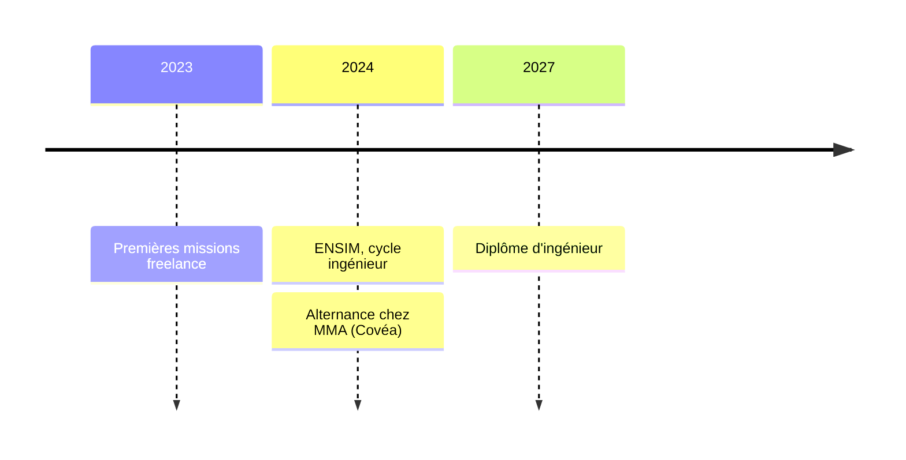
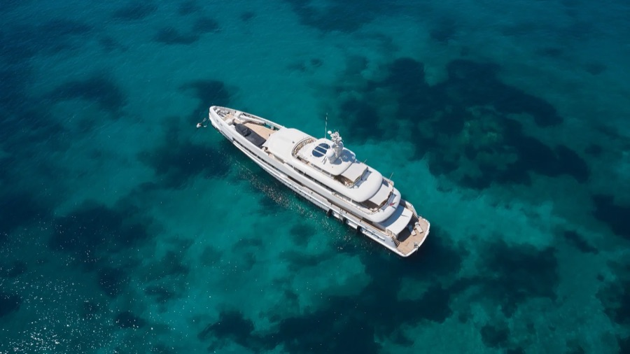
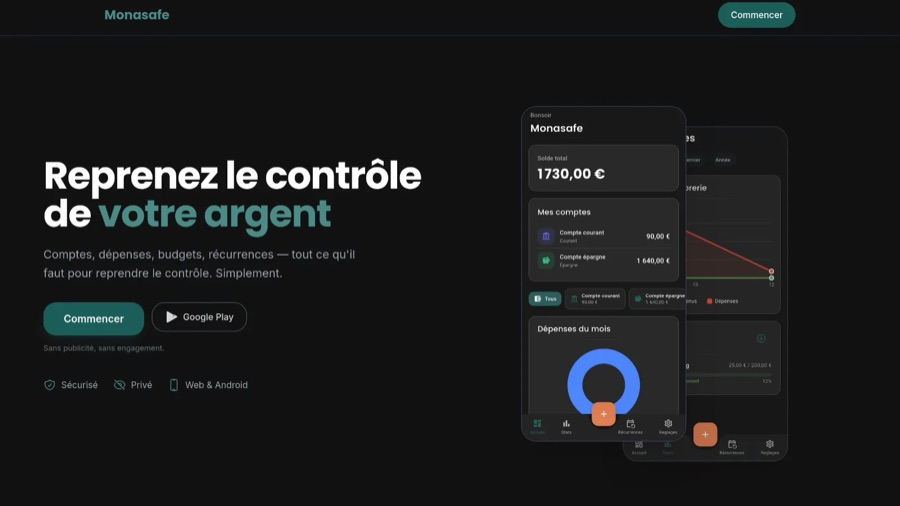
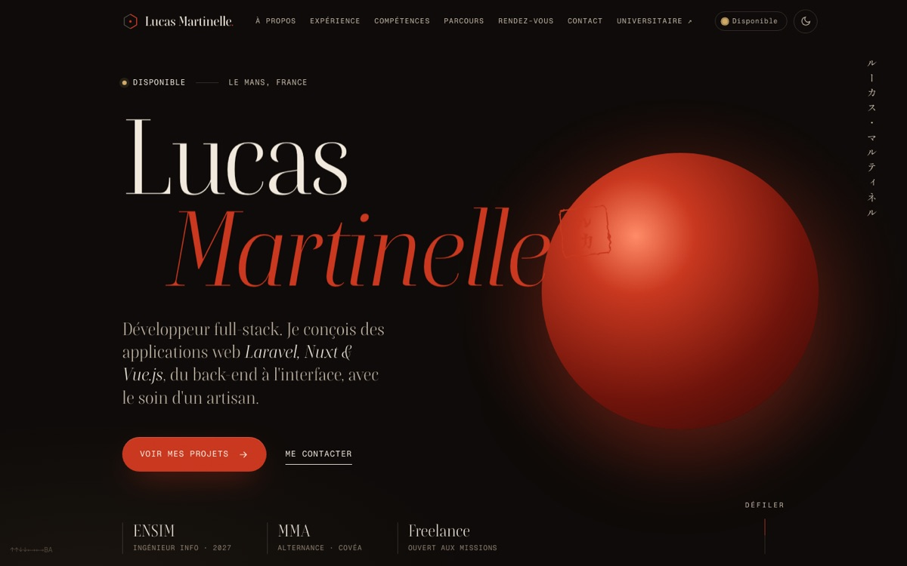

  

  
  
  
  
  

## 🧭 Parcours

## 🚀 Projets

<table>
  <tr>
    <td width="33%" align="center"> <b>MyAssistantPro</b> 💼 Mise en relation assistant(e)s / recruteurs Laravel · Livewire</td>
    <td width="33%" align="center"> <b>Yachts Events</b> 💼 Yachting de luxe <i>(en cours)</i> Nuxt · Laravel</td>
    <td width="33%" align="center"> <b>Yacht Collection</b> 💼 Gestion commerciale <i>(en cours)</i> Laravel · Vue.js</td>
  </tr>
  <tr>
    <td width="33%" align="center"> <b>Monasafe</b> 🌱 Finances perso, open-source Nuxt · Flutter · Supabase</td>
    <td width="33%" align="center"> <b>AllTheRiders</b> 🏍️ Balades à moto <i>(en cours)</i> Flutter · Mapbox</td>
    <td width="33%" align="center"> <b>FetcherREP</b> 🔐 Rapports HackerOne Open-source</td>
  </tr>
</table>

  🏢 <b>MMA</b> : migration fiscalité, refonte dossiers décès, DDD (Angular · Java EE) 
  🌐 <a href="https://luriel-dev.com/"><b>luriel-dev.com</b></a> : portfolio, espace client, facturation Factur-X (Nuxt 4)

<a href="https://calendar.app.google/xn5m8BnBHZ9WQgEJ7"><b>📅 Une mission en tête ? Réserver un créneau</b></a>

## ⚙️ Stack

  

## 📊 Sur GitHub

  
  

  

  

