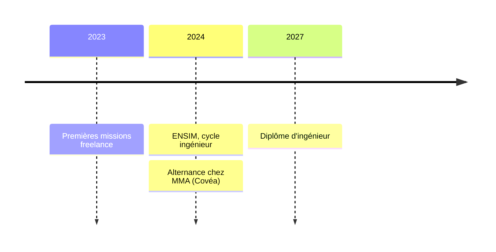

  

  
  
  
  
  

## 🧭 Parcours

## 🚀 Projets

| | Projet | Stack |
|:-:|---|---|
| 💼 | [**MyAssistantPro**](https://www.myassistantpro.fr/) · mise en relation assistant(e)s / recruteurs | Laravel · Livewire |
| 💼 | **Yachts Events** · site événementiel nautique *(en cours)* | Nuxt · Laravel |
| 💼 | **Yacht Collection** · gestion commerciale *(en cours)* | Laravel · Vue.js |
| 🏢 | **MMA** · migration fiscalité, refonte dossiers décès, DDD | Angular · Java EE |
| 🌐 | [**luriel-dev.com**](https://luriel-dev.com/) · portfolio, espace client, facturation Factur-X | Nuxt 4 · SQLite |
| 🏍️ | **AllTheRiders** · balades à moto *(en cours)* | Flutter · Mapbox |

  
  

<a href="https://calendar.app.google/xn5m8BnBHZ9WQgEJ7"><b>📅 Une mission en tête ? Réserver un créneau</b></a>

## ⚙️ Stack

  

## 📊 Sur GitHub

  
  

  

  

